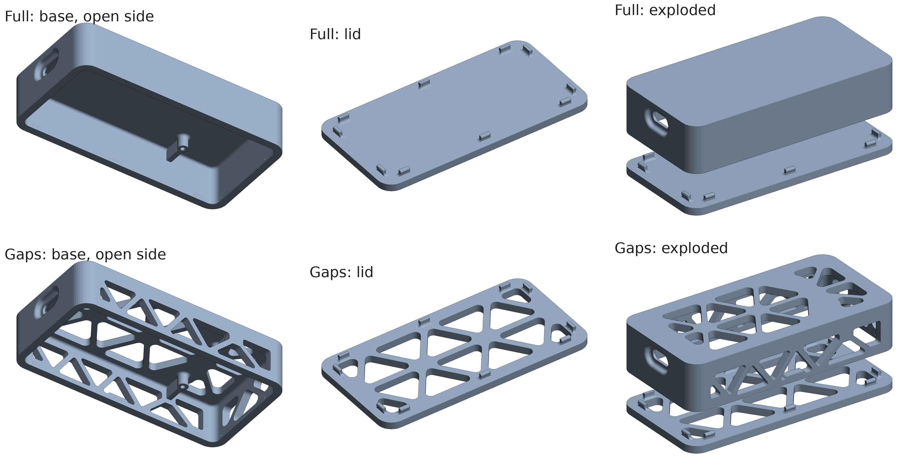
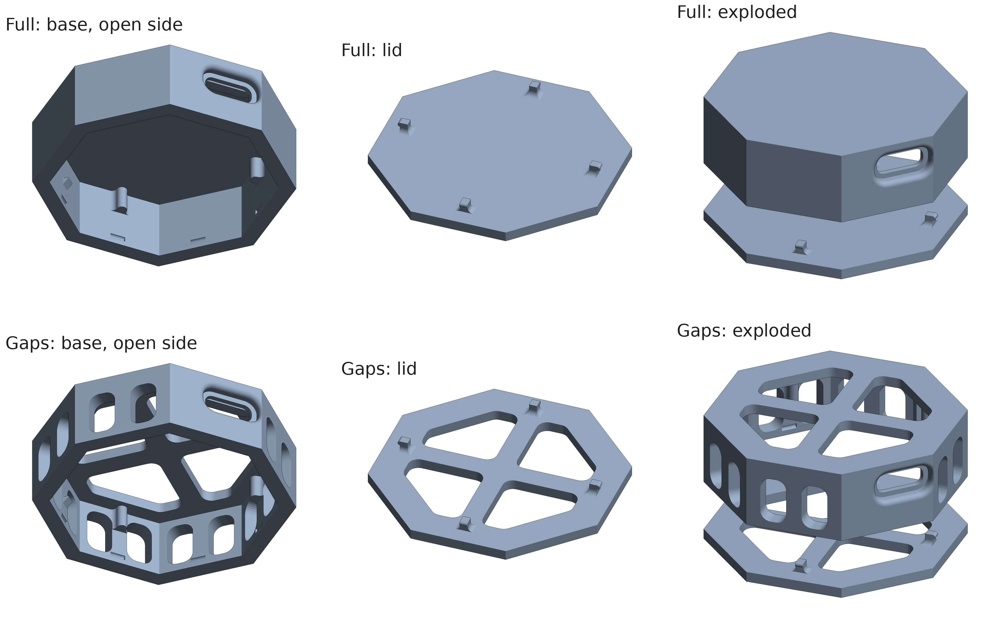

# UWB Stella-Shield enclosures

3D-printable enclosures for the two boards of the UWB Stella-Shield prototype, an indoor guidance system based on ultra-wideband (UWB) ranging.

- The Shield enclosure holds an Arduino Portenta C33 carrying a Portenta UWB Shield. This is the stationary anchor.
- The Stella enclosure holds an Arduino Stella board. This is the mobile tag.

Each enclosure has a base and a snap-on lid. It comes in two variants with the same outer dimensions and internal features: Full, with solid walls, and Gaps, with the walls and panels cut into an open lattice. All four variants have been printed and assembled with the boards inside.





## Repository layout

```
.
├── README.md
├── LICENSE                      CC BY 4.0
├── CITATION.cff
├── docs/
│   ├── PRINTING.md              print settings, orientation, assembly
│   └── img/                     renders used in this README
├── stl/
│   ├── shield/                  4 files: base and lid, Full and Gaps
│   └── stella/                  4 files: base and lid, Full and Gaps
└── gcode/
    └── prusa-mk4/               9 sliced files (.bgcode) for the Original Prusa MK4
```

There is no generating script. The parts exist only as exported STL files; the CAD source is not included.

## Parts

Units are millimeters. Mass and print time are PrusaSlicer estimates; the printed parts were not weighed.

| Part | File | Bounding box (mm) | Mass (g) | Print time |
|---|---|---|---|---|
| Shield base, Full | `stl/shield/shield-base-full.stl` | 91.1 x 45.5 x 19.5 | 21.79 | 1 h 36 min |
| Shield lid, Full | `stl/shield/shield-lid-full.stl` | 91.1 x 45.5 x 5.3 | 10.94 | 40 min |
| Shield base, Gaps | `stl/shield/shield-base-gaps.stl` | 91.1 x 45.5 x 19.5 | 15.82 | 1 h 35 min |
| Shield lid, Gaps | `stl/shield/shield-lid-gaps.stl` | 91.1 x 45.5 x 5.3 | 6.96 | 38 min |
| Stella base, Full | `stl/stella/stella-base-full.stl` | 45.4 x 45.4 x 14.0 | 8.41 | 38 min |
| Stella lid, Full | `stl/stella/stella-lid-full.stl` | 45.4 x 45.4 x 4.1 | 4.18 | 15 min |
| Stella base, Gaps | `stl/stella/stella-base-gaps.stl` | 45.4 x 45.4 x 14.0 | 5.74 | 38 min |
| Stella lid, Gaps | `stl/stella/stella-lid-gaps.stl` | 45.4 x 45.4 x 4.1 | 2.67 | 14 min |

Each STL file holds one watertight body. The base and the lid of a variant share one coordinate system, so they import in their assembled position.

A complete Full Shield enclosure takes about 32.7 g of filament and a Gaps one 22.8 g. For the Stella enclosure the figures are 12.6 g and 8.4 g.

## Dimensions

Measured on the STL meshes and rounded to 0.1 mm. Full and Gaps give the same values except for the open area.

| Feature | Shield enclosure | Stella enclosure |
|---|---|---|
| Outline | Rounded rectangle, 91.1 x 45.5 mm, corner radius 6.0 mm | Regular octagon, 45.4 mm across flats, 18.8 mm sides |
| Base height | 19.5 mm | 14.0 mm |
| Lid height | 5.3 mm (3.0 mm plate, 2.3 mm tabs) | 4.1 mm (2.0 mm plate, 2.1 mm tabs) |
| Assembled height | 22.6 mm | 16.0 mm |
| Wall thickness | 3.0 mm | 3.0 mm |
| Closed panel thickness | 3.0 mm | 2.0 mm |
| Cavity | 85.1 x 39.5 mm, 16.5 mm deep | 39.4 mm across flats, 12.0 mm deep |
| Board supports | Four standoffs, 5.0 mm tall, each with a 1.8 mm blind hole about 3.5 mm deep | Three corner pads, 4.6 mm tall, and two bumps on opposite walls 1.2 mm beyond the pad plane |
| Support pattern | Hole centers 62.0 mm apart along the length, 21.3 mm across the width | Pads on three of the four diagonal faces |
| USB-C opening | End wall: 9.9 x 4.2 mm slot inside a 13.7 x 8.0 mm recess | Diagonal face: 9.5 x 3.8 mm slot inside an 11.5 x 5.8 mm recess |
| Lid retention | 10 snap tabs, 4.0 mm wide | 4 snap tabs, 1.5 mm wide; grooves on all eight faces |
| Open area, Gaps variant | Lid 46 %, closed panel 36 %, long walls 36 % | Lid 39 %, closed panel 39 %, side walls 28 % |

## Board fit

| Board | Board size (datasheet) | Cavity | Clearance |
|---|---|---|---|
| Arduino Stella (ABX00131) | 38.0 x 38.0 mm | 39.4 mm across flats | 0.7 mm per side |
| Portenta UWB Shield (ASX00074) | 70.1 x 37.5 mm | 85.1 x 39.5 mm | 1.0 mm per side across the width, 15.0 mm in total along the length |
| Arduino Portenta C33 (ABX00074) | 66.04 x 25.40 mm | same cavity | sits on the four standoffs |

The standoff holes in the Shield base are positions for M2 screws. The units tested so far were assembled without screws. The Stella enclosure has no screw holes.

## Printing

The parts were sliced in PrusaSlicer 2.9.6 for an Original Prusa MK4 with a 0.4 mm nozzle: PLA, 0.20 mm layers, 2 perimeters, 15 % gyroid infill, no supports. Print the bases with the open rim on the bed and the lids with the plate on the bed. Full settings, orientation and assembly steps are in [docs/PRINTING.md](docs/PRINTING.md).

The `.bgcode` files in `gcode/prusa-mk4/` are ready to print on an MK4. For any other printer, slice the STL files.

## Status and limits

- Fit was checked by assembly for all four variants.
- No measurement data on the effect of the enclosures on UWB ranging are available yet.
- The tested units were assembled without the mounting screws.
- Full and Gaps are alternative designs. The Gaps variant also serves to check whether the enclosure material affects the ranging measurements. It uses 30 % to 33 % less filament than the Full variant.

## Related work

The ranging measurements made with these boards are described in:

R. A. Muntean, H. Balta, M. Kovaci, A. Vesa, and V. A. Niță, "Experimental characterization of UWB distance measurement error as a function of transmit power and tag localization using a mobile anchor," presented at the Int. Symp. Electron. Telecommun. (ISETC), Timișoara, Romania, 2026.

The firmware and the phone apps of the prototype are not part of this repository.

## How to cite

See [CITATION.cff](CITATION.cff), or use the "Cite this repository" button on GitHub.

## License

The design files and the documentation are licensed under the [Creative Commons Attribution 4.0 International License](https://creativecommons.org/licenses/by/4.0/) (CC BY 4.0). See [LICENSE](LICENSE).
